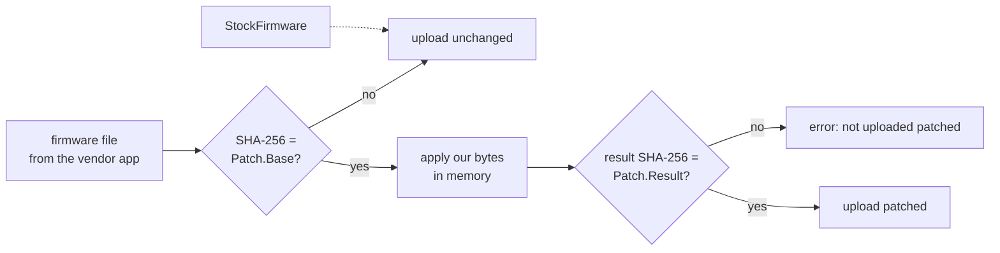
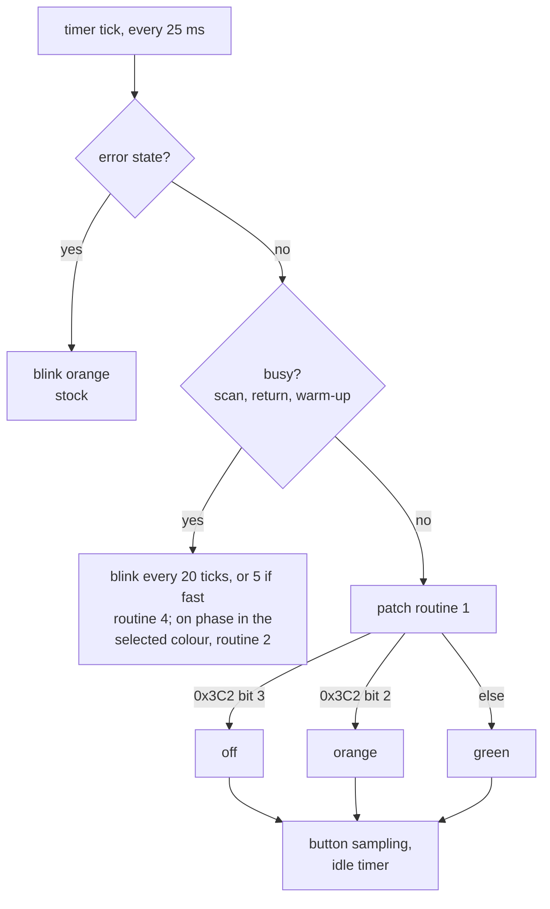

# Firmware patches

The scanner has no flash memory for its firmware: the host uploads it
after every power-on, and it runs from RAM. lib-v370 can change it on the
way. A **patch** is a short list of our own bytes at payload offsets
(`firmware.Patch`). It contains none of the vendor's code, and no modified
firmware file is ever written or distributed. The patch is applied in
memory just before the upload:

- only to the one vendor build it was made for (SHA-256 of the file is
  pinned in `Patch.Base`), and
- only if the result has the pinned SHA-256 (`Patch.Result`).

Any other firmware file is uploaded unchanged. A power cycle always
restores the original.



Switching it off: `v370.Options.StockFirmware` (library),
`-stock-firmware` (tool `v370`), `--v370-stock-firmware`
(scanSTATION server). The upload log names the applied patches
(`patches=[led]`).

## Summary of improvements

| | Stock firmware | With the `led` patch |
|---|---|---|
| LED states the host can set (`1e de`) | green, orange | green, orange, **off** |
| Buttons while the LED is orange | **not detected** (the orange state skips button sampling and the idle timer) | detected in every LED state |
| LED while the scanner is busy (scanning, carriage return, warm-up) | always blinks green, 0.5 s | blinks in the **selected colour** (green or orange) |
| Blink speed while the image is transferred | same as every busy state | **4 times faster** (0.125 s on / off) on request (`1e de 80`); the host asks for it just before the image pass |
| Colour after a scan job (`1b 40`) | reset to green | **kept** |

What the host makes of it (scanSTATION server, button scans): off as
soon as a press is registered; green blinking for a single page; orange
flash at 1 s (release = cancel); orange blinking and orange for a
multi-page document; off → green when Power finishes it. In every scan:
slow blinking during warm-up, calibration and carriage return, fast
blinking while the image is transferred. Details:
scanSTATION-server README, "Multi-page PDFs".

Verified on the scanner on 2026-11-08: the patch loads, all three LED
states, buttons while orange, the busy blink in orange during document
pages, the colour kept across pages, and the full button sequence above.
The fast transfer blink (4 Hz while the image is transferred) was
verified the same day.

## `led` — LED off state, buttons active in every LED state, coloured and fast busy blink

### Findings (static analysis, verified on the scanner)

- The panel LED is a two-colour LED on ASIC register `0x37FD00` bits 4/5:
  `10` green, `01` orange, `11` off. The 25 ms timer tick (`0x020011B6`)
  sets it 40 times a second: error states blink orange (off ↔ orange,
  0.5 s), start-up blinks green, otherwise RAM `0x3C2` bit 2 selects
  orange (set) or green.
- `1e de` + 1 byte (handler `0x02006A12`, not used by the vendor app) sets
  `0x3C2` bit 2 to bit 0 of the byte: green ↔ orange works with the stock
  firmware. But the stock orange branch jumps over the tick's button
  sampling and idle timer, so buttons are not detected while the LED is
  orange, and there is no command for off.
- While the scanner is busy (scanning, carriage return, warm-up), the tick
  ignores the selection and blinks green itself (`0x020012F2` ff.): the
  counter RAM `0x3C5` advances once per LED tick (25 ms), and the LED
  toggles when it is divisible by 20 (`ld.w %r13,0x14` at `0x02001306`,
  modulo routine `0x0200BED2`) — 0.5 s for every busy state alike; the
  firmware does not tell the image pass apart. The re-initialisation
  `0x02001786`, which `1b 40` calls at the end of every job, clears
  `0x3C2` bit 2 (back to green).
- RAM `0x3C2`: the firmware uses bits 1, 2, 4, 5, 6 (bit 4 in the button
  code at `0x020015A4`/`0x02001618`); bits 0, 3 and 7 are unused.

### Tick after the patch



### RAM `0x3C2` bits used by the patch

| Bit | Meaning | Set by | Cleared by |
|---|---|---|---|
| 2 | orange (stock meaning) | `1e de 01` | `1e de 00` / `02` |
| 3 | off | `1e de 02` | `1e de 00` / `01` |
| 7 | fast busy blink | `1e de 80` (colour unchanged) | `1e de 00`/`01`/`02`, end of job (`1b 40`) |

### Changes (`firmware.LEDPatch`, 7 changes)

| Load address | Change |
|---|---|
| `0x0200C9D4` (free area, `0xFF` before) | routine 1: `0x3C2` bit 3 → off; else bit 2 → orange; else green; then continue at `0x02001392` (button sampling, idle timer) in every case |
| `0x02001374` | jump to routine 1 (the stock selection behind it becomes unreachable) |
| `0x0200CA06` (free area) | routine 2, busy blink "on" phase: orange while `0x3C2` bit 2 is set, else green; continue at `0x02001336` |
| `0x02001332` | the busy blink's "on" phase jumps to routine 2 |
| `0x0200CA20` (free area) | routine 3, `1e de` parameter: `80` → set bit 7 only; else parameter bits 0/1 → RAM bits 2/3, clear bits 2, 3, 7 |
| `0x02006A28` | `1e de` handler jumps to routine 3 (continues at `0x02006A38`) |
| `0x0200CA46` (free area) | routine 4, busy blink divisor: 20, or 5 while bit 7 is set; then the counter restarts at 5 so the period stays even when it would wrap at 256 |
| `0x02001300` | busy blink jumps to routine 4 (the replaced counter load is repeated there; 2 `nop` follow; continues at `0x02001308`, modulo and toggle) |
| `0x020019D0` | re-initialisation: `bclr [0x3C2],2` → `bclr [0x3C2],7` (the colour survives `1b 40`, fast blinking ends there) |

Our code in the free area:

```text
; routine 1: normal LED selection (entered from 0x02001374)
ld.w  %r11,0x37fd00
btst  [%r8+0x1c2],3 ; jreq L1                        ; RAM 0x3C2 bit 3: off
bset  [%r11],4 ; bset [%r11],5 ; jp 0x02001392
L1: btst [%r8+0x1c2],2 ; jreq L2                     ; bit 2: orange
bclr  [%r11],4 ; bset [%r11],5 ; jp 0x02001392
L2: bset [%r11],4 ; bclr [%r11],5 ; jp 0x02001392    ; green

; routine 2: busy blink "on" phase (entered from 0x02001332, %r11 = LED)
btst  [%r8+0x1c2],2 ; jreq G                         ; orange selected?
bclr  [%r11],4 ; bset [%r11],5 ; jp 0x02001336        ; orange
G: bset [%r11],4 ; bclr [%r11],5 ; jp 0x02001336     ; green

; routine 3: 1e de parameter (entered from 0x02006A28, %r12 = 0x3C2)
ld.ub %r11,[%sp] ; ld.ub %r10,[%r12] ; ld.w %r13,%r11
and   %r13,0x80 ; jreq C
or    %r10,0x80 ; jp S                               ; fast, colour kept
C: and %r11,0x3 ; sll %r11,2 ; and %r10,0x73 ; or %r10,%r11
S: ld.b [%r12],%r10 ; jp 0x02006A38

; routine 4: busy blink divisor (entered from 0x02001300)
ld.ub %r12,[%r8+0x1c5] ; ld.w %r13,20                ; counter, slow divisor
btst  [%r8+0x1c2],7 ; jreq B
ld.w  %r13,5 ; cmp %r12,5 ; jrult B                  ; fast: divisor 5,
ld.w  %r12,0 ; ld.b [%r8+0x1c5],%r12                 ; counter restarts at 5
B: jp 0x02001308                                     ; modulo, toggle
```

RAM is cleared at reset, so bits 3 and 7 start cleared.

### Safety

- Only the LED output bits (`0x37FD00` bits 4/5), three bits of RAM
  `0x3C2` and, while fast, the blink counter `0x3C5` are touched. Motor, lamp, CCD, USB and NV code is unchanged, and the button
  sampling and idle timer (auto power-off) now run in every LED state.
- Every branch of the new code ends in a jump back to the stock code; the
  free area was `0xFF` (unused) before.
- The scanner accepts any payload with the right 1-byte sum, and the
  driver computes it; a power cycle loads the original again (see
  `research/firmware-mod.md`).

### Use

- Library: `v370.Scanner.SetLED(LEDGreen | LEDOrange | LEDOff)` (`1e de`
  00 / 01 / 02). With stock firmware `LEDOff` shows green.
- Fast transfer blink: `RunProfile` sends `1e de 80` while the scanner is
  ready, just before the image pass (`1e 47` followed by the image read),
  if the patch is known to run: this session uploaded it, or
  `LEDPatched` found it (the scanSTATION server checks before each scan).
  Nothing extra is sent mid-scan. `Options.NoTransferBlink` (tool
  `-no-transfer-blink`, server `--v370-no-transfer-blink`) switches it
  off. Stock firmware never gets `1e de 80` (it would read it as green).
- `v370.Scanner.LEDPatched` reads routine 1's first bytes back from the
  scanner's RAM (read-only memory read `1e 83` type 8): true if the patched
  firmware is running.
- Tool: `v370 led` (test sequence: orange, green, quick changes;
  `-off` uses the off state); `v370 mem` reads RAM, e.g. `0x3C2`.

Pinned values: input file `2fec0d33…dd954` (vendor app 6.7.82.0), patched
payload `28269a04…20b6`. Tests: `firmware/patch_test.go` (with the real
file via `LIBV370_FIRMWARE`), `sim/synth` (`Options.LEDPatch`), the
server's LED sequence tests.

## Adding a patch

1. Find the code to change with the disassembler
   (`docs/research/tools/firmware`; listings are generated from your own
   copy of the firmware and not kept in git). Keep away from motor, lamp
   and CCD code (`docs/research/improvements.md` §C).
2. Put new code into the free area (payload `0xC9D4`–`0xFFFF`; `led` uses
   `0xC9D4`–`0xCA6B`), assemble with `s1c33asm.py`, check the disassembly.
3. Define a `firmware.Patch` with the bytes and both SHA-256 values; add a
   marker if the host needs to detect it.
4. Test on the scanner (power cycle = undo).
