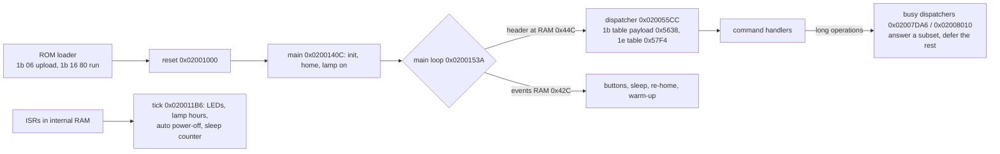

# esfwdd.bin firmware map (Perfection V37/V370, GT-F740, USB 04b8:014a)

This is a reference for maintaining our own driver. It is static analysis only (2026-11-07). No
scanner access was used for it.

- **[V]** = verified: read in the code (address given), in traces/profiles, or on the device.
- **[I]** = inferred.
- **[U]** = unknown.

Addresses are **load addresses** (0x0200xxxx) unless marked "payload" or "file".

Companion files (`docs/research/`):
- `supported-modes.md`: resolutions, bit depths, channels, limits.
- `improvements.md`: what to try, plus the risky internals.
- `tools/firmware/out/`: generated listings (not in git — they contain disassembled vendor code); rebuild them with §8.
- `tools/firmware/`: the tools.

## 1. Quick facts

| Item | Value | |
|---|---|---|
| CPU | The vendor S1C33000 (C33), 16-bit instructions, little-endian | [V] |
| File | 65 793 B = 256 B `EDLA` header + 65 536 B payload + 1 trailing byte (not sent) | [V] |
| Address conversion | **load = 0x02000000 + payload**, **file = payload + 0x100** | [V] |
| Integrity | only `sum8(payload)`, computed and sent by the host (stock 0xAF) | [V device] |
| Free space | payload 0xC9D4–0xFFFF all 0xFF (13 868 B); also 0x0200–0x03FF and 0x07B4–0x0FFF | [V] |
| Global base | `r8 = 0x200` everywhere. `[r8+X]` = internal RAM 0x200+X. `[r8+0x37Fxxx]` = ASIC 0x37Fxxx + 0x200 | [V] |
| Stack | SP = 0x1000, at the top of the 4 KiB internal RAM | [V] |
| Memory | internal RAM 0x000–0xFFF; external RAM 0x02000000–≥0x021FFFFF; ASIC registers 0x37F000–0x37FFFF; C33 peripherals 0x40000–0x4FFFF; mask ROM ≈0xC00000 | [V refs, I sizes] |
| Pointers kept in RAM | 0x3E0 = 0x310000 (USB controller base); 0x3DC = 0x40000 (peripheral base) | [V main 0x02001414] |
| Calling convention | arguments r12–r15, result r10, r0–r3 saved by the callee, r8 fixed | [V by use] |



## 2. Memory map of the payload

| Payload | File | Load | Content | |
|---|---|---|---|---|
| 0x0000–0x01FF | 0x0100–0x02FF | 0x02000000 | trap/vector table. Copied to internal RAM 0x000 at start; the trap stubs at 0x120–0x137 hang the CPU on an unexpected trap | [V] |
| 0x0200–0x03FF | 0x0300–0x04FF | 0x02000200 | 0xFF, unused | [V] |
| 0x0400–0x07B3 | 0x0500–0x08B3 | runs at **0x4A0–0x853** | code copied to internal RAM: interrupt stubs (0x4A0/4B8/4D0/4E8), interrupt disable 0x500 / enable 0x50E, ASIC timer IRQ 0x51C, USB helpers (0x6B8 = "host data pending?", 0x6FA, 0x716, 0x7C6, 0x7FE), fast transfer loop 0x5FC (used by 1e 47) | [V] |
| 0x07B4–0x0FFF | 0x08B4–0x10FF | | 0xFF, unused | [V] |
| 0x1000–0x10FB | 0x1100 | 0x02001000 | C start-up (reset) 0x02001000, warm restart 0x020010C2 (main(1)), NMI halt 0x020010BC, soft restart via vector 0x50 at 0x020010FC (main(0)) | [V] |
| 0x1180–0x140B | 0x1280 | 0x02001180 | tick timer init 0x02001180, tick handler 0x020011B6, one-shot timer 0x020013CA (callback pointer at RAM 0x200), delay 0x020013F8 | [V] |
| 0x140C–0x1755 | 0x150C | 0x0200140C | `main` and the main loop | [V] |
| 0x1756–0x1ACF | 0x1856 | 0x02001756 | RAM defaults 0x02001786; scan-block defaults 0x02001A4E | [V] |
| 0x1AD0–0x2D1F | 0x1BD0 | 0x02001AD0 | **motor**: IRQ 0x02001C24/0x02001C38, move with built-in speed table 0x02001CA8, move with deferred commands 0x0200215E, boot homing 0x0200261E, segments 0x02002742/0x02002800, scan move 0x02002906, "motor busy" 0x02002D14 | [V names I] |
| 0x2B56–0x2D13 | 0x2C56 | 0x02002B56 | **lamp**: restore 0x02002B56, off for sleep 0x02002B88, flatbed on 0x02002BA8 / off 0x02002BD6, TPU on 0x02002BFA / off 0x02002C3E, low-level 0x02002C7C / 0x02002CC8 | [V] |
| 0x2D20–0x4143 | 0x2E20 | 0x02002D20 | **USB device stack**: controller init 0x02002D20, bus reset 0x0200300E, standard requests 0x02003210 (20 sub-handlers 0x02003458–0x02003D24; descriptors at 0x02003458/0x0200347E/0x0200350A/0x02003530/0x02003558), bulk IN send(buf r12, len r13) **0x02003D8C**, bulk OUT receive **0x02003E40**, DMA paths 0x02003F82 / 0x02004044 | [V] |
| 0x4144–0x4BC3 | 0x4244 | 0x02004144 | board init 0x020042A8 → GPIO/buttons 0x020042E6, IRQ setup 0x0200437C, timers 0x020043CA, USB DMA 0x020043FE, CCD/lamp timing 0x02004428, front-end registers 0x020045A6, shading 0x02004656, motor 0x02004682; model detection 0x020047E2 (→ RAM 0x3BE); button event 0x0200480E, button sampler 0x02004830, wake 0x0200494A, sleep 0x02004A18, front-end power 0x02004AF8 (on) / 0x02004B20 (off) [I], motor driver enable 0x02004B3C | [V] |
| 0x4BC4–0x4BF3 | 0x4CC4 | 0x02004BC4 | 6 × 4-u16 records used by the lamp measurement (0x0200B66A, 0x0200BCFE). Second column 40800/n, n = 1, 2, 4, 8, 12, 16 | [V data, U meaning] |
| 0x4BF4–0x4C73 | 0x4CF4 | | 64 increasing u16 (1001…8072), used by 0x0200A1F4 | [V data, U] |
| 0x4C74–0x4CF3 | 0x4D74 | | motor current/phase tables, used by 0x02004682, 0x02009D16, 0x02009DCC | [V refs, I] |
| 0x4CF4–0x5473 | 0x4DF4 | | **motor speed (step-period) tables**, all starting at 2500: 0x4CF4 (256 entries →222) + 0x4EF4 (128 →222); 0x4FF4 (256 →192) + 0x51F4 (128 →192); 0x52F4 / 0x5374 / 0x53F4 (64 each, ending at 333/400/587; not referenced directly) | [V data, I meaning] |
| 0x5474–0x547F | 0x5574 | | small table (62, 104, 155), used by 0x0200261E | [V] |
| 0x5480–0x558B | 0x5580 | | USB descriptors: device 0x5480, configuration 0x5492, qualifier 0x54B2, language 0x54C0, strings 0x54C4…0x554C | [V] |
| 0x558C / 0x55A8 | 0x568C / 0x56A8 | | identity strings for `GT-F740` / `GT-S640` (version `1.00`); F740 version digits at payload 0x55A4–0x55A7 | [V device] |
| 0x55C4–0x55CB | 0x56C4 | | horizontal divider table 1, 2, 4 … 128 (1e 41 byte 8) | [V] |
| 0x55CC–0x5E3B | 0x56CC | 0x020055CC | **command dispatcher**: 1b table 0x5638, 1e table 0x57F4, stubs; common return 0x02005E38; NAK 0x02005E34 | [V] |
| 0x5E3C–0x7D9F | 0x5F3C | | command handlers (§5); ACK 0x020077B8, NAK 0x020077CE | [V] |
| 0x7DA6–0x8479 | 0x7EA6 | 0x02007DA6 | busy dispatchers 0x02007DA6 (table 0x7E2C) and 0x02008010 (tables 0x8064, 0x815C); unknown commands are deferred (RAM 0x44E = 1) | [V] |
| 0x847A–0x87EB | | | 1e 77/86/8a/89/99/9a/9f; 1b 16 handler 0x020086C8, restart helpers 0x0200879C / 0x020087AE / jump to ROM 0x020087EA | [V] |
| 0x8830–0x8B2F | 0x8930 | | **CCD timing waveforms**, 6 modes × 64 u16 (1e 11) | [V] |
| 0x8B30–0x8C3B | | | front-end tables, used by 0x02009354/0x02009402 | [V refs] |
| 0x8C20–0x94CD | | 0x02008C20 | front end (analog front end + timing chip, serial interface on ASIC 0x37F0D4/D5): register write 0x02008E34, reads 0x02008F38/0x02008F5A, apply 0x02008F7E (1e 9b), sensor mode 0x02009152 (1e 11), line timing 0x02009354/0x02009402, commit 0x020094CE, per-channel gain/offset 0x0200C618 | [V] |
| 0x95B8–0x9737 | 0x96B8 | | **three 128-byte default NV images** (V37/V370 PID 014a; GT-S640/F740 PID 014a; PID 0131 generic "Scanner" name), written only by 1e 98 | [V] |
| 0x9738–0x9CC3 | | 0x02009738 | **NV memory**: 64 × 16-bit words, bit-banged on ASIC 0x37F0D0 [I: serial EEPROM]. Read word 0x02009738, write 0x020099D2, write pair 0x02009A00, read pair 0x02009A32, increment 0x02009A56, test 0x02009A6A, write default image 0x02009B8E | [V] |
| 0x9CC4–0xA08B | | 0x02009CC4 | motor current tables 0x02009CC4, phase tables 0x02009D16/0x02009DCC, optics select 0x02009E80 (1e 25) | [V refs, I] |
| 0xA08C–0xBF33 | | 0x0200A08C | **lamp check / warm-up / home / calibration**: idle lamp check 0x0200A08C, pass set-up 0x0200A3CE, capture start 0x0200A5C6, gains 0x0200A642, re-home 0x0200A694, white strip/home 0x0200A716, shading-memory clear 0x0200A880, position measurement 0x0200A900 (1e 87 data), warm-up 0x0200AB64, 1e 46 0x0200B20A, measurement 0x0200B314, **measurement loop that drops commands 0x0200B416**, 1e 04 0x0200B5D8, level evaluation 0x0200B712, gain adjust 0x0200BC42 | [V names I] |
| 0xBE9C–0xBF33 | | | math helpers: 0x0200BED2 modulo, 0x0200BF16 divide | [I] |
| 0xBF34–0xC617 | | 0x0200BF34 | interrupt handlers: USB 0x0200BF34 (→ control requests 0x0200C2CA), 0x0200BFC4, 0x0200BFFA (→ motor IRQ); USB reset/suspend 0x0200C104/0x0200C212 | [V] |
| 0xC618–0xC9D3 | | 0x0200C618 | gain/offset per channel 0x0200C618; sensors 0x0200C784–0x0200C7D2; **auto power-off** 0x0200C804–0x0200C95E; **power-off** 0x0200C966 | [V] |

## 3. Internal RAM variables (RAM address = `[r8+X]` + 0x200)

| RAM | Meaning | Writers → readers | |
|---|---|---|---|
| 0x000–0x1FF | vector table copy | start-up | [V] |
| 0x200 | timer-2 callback pointer | 0x020013CA → IRQ 0x020013EE | [V] |
| 0x204–0x303 | 256-byte command parameter/reply buffer | handlers | [V] |
| 0x304 / 0x308 / 0x30C / 0x310 | line period / per-channel exposure (1e 21, 1e b1) | 0x020061E0 → 1e b0, lamp | [V] |
| 0x340–0x344 | gains (1e 43) | 0x020069A8 → 0x0200B712 | [V] |
| 0x348 / 0x34C | 1e 01 step count / u16 | 0x02006058 → motor | [V] |
| 0x34E | 1e 41 byte 10 = motor steps per line | 0x020066FA → 0x02002742 | [V] |
| 0x350 / 0x354 / 0x35C / 0x360 / 0x370 | data size / bytes per transfer + 8 / transfer count (from 1e 41) | 0x020066FA → data path | [V] |
| 0x358 | shading end pointer | 1e 84 type 5, passes | [V] |
| 0x378 | motor direction/mode (1e 01 byte 10) | 0x02006058 → motor | [V] |
| 0x379–0x3BC | USB stack state (0x37A = USB state, 4 = configured [I]; 0x3BA = wLength; 0x3BC = max packet size 64/512) | USB | [V/I] |
| 0x3BE | model variant (bits 0–2: 1 = GT-F740/V370). Also status byte 1 | 0x020047E2 | [V] |
| 0x3BF / 0x3C0 / 0x3C2 / 0x3CF | flag bytes (motor, pass, power state; 0x3CF bits 0–1 = optics mode, bit 7 = error) | many | [V partial] |
| 0x3C1 | **status byte 0 source**: bit 6 busy, bit 1 warming up, bit 7 fatal error | motor/lamp → 1b 03 0x02006EB2 | [V] |
| 0x3C3 | button wait-for-release | sampler | [V] |
| 0x3C5 | LED blink phase counter (toggle every 20 ticks = 0.5 s in the blink states) | tick | [V] |
| 0x3C9–0x3CE | front-end gain/offset per channel | 1e 46 measurement → 1e 9b | [V] |
| 0x3E5 / 0x3EA / 0x3EC | lamp-on time counters (6 s sub-counter, flatbed, TPU) → NV words 0x2E / 0x30 once a minute | tick → main | [V] |
| 0x3F0–0x418 | **1e 53/1e 57 block** (only byte 0x1A at 0x40A is read elsewhere) | 0x020079FA → 0x0200788E | [V] |
| 0x41C–0x426 | 1e 31 / 1e 92 levels | | [V] |
| 0x428 | light-source state (bits 0–2: 0 off, 1 flatbed, 2 TPU, 3 TPU off) | lamp → 1e a1 | [V] |
| 0x42C | main-loop events: bit 0 buttons (40 Hz), bit 1 re-home check, bit 2 warm-up, bit 6 sleep | tick/handlers → main | [V] |
| 0x42D / 0x42E | warm-up flags / **error flags** (1e 65; bits 0, 2, 4 tested) | | [V] |
| 0x434 / 0x436 | carriage position counters (1e 86) | motor | [V/I] |
| 0x43C | asleep flag | 0x02004A18 / 0x0200494A | [V] |
| 0x43D, 0x45A–0x460 | boot measurement (1e 87) | 0x0200A900 | [V] |
| 0x440–0x447 | lamp measurement: done mask, result 0x443 (1e 04), levels 0x444–0x446, round counter 0x447 (1e ff) | 0x0200B20A… | [V] |
| 0x448–0x44A | levels set by 1e 99, read by 1e 9a | | [V] |
| 0x44C / 0x44D / 0x44E | received command prefix / command / "deferred command pending" | | [V] |
| 0x44F | tick divider (25 interrupts → 40 Hz) | | [V] |
| 0x450–0x452 | button latch / count / candidate | | [V] |
| 0x456 | sleep counter (sleep at 0x8660 = 34 400 ticks ≈ 14.3 min) | tick | [V] |
| 0x466 / 0x468 | two u16 set by 1e 8a, read by 1e 89 | | [V] |
| 0x470 | horizontal offset added to the 1e 41 start/end | | [V] |
| 0x472 | sensor mode (1e 11) | 0x0200455A | [V] |
| 0x476 | session open (1e 93) | | [V] |
| 0x478 / 0x479 | 1e 21 bytes 26/27 | | [V] |
| 0x47A | clock already written | 1e 8e | [V] |
| 0x488–0x494 | auto power-off: enable / limit / counter; 0x48C/0x48D = ErP supported | | [V] |

The full cross-reference is in `out/fw.ram.txt`.

## 4. ASIC and peripheral registers (as far as known)

| Address | Use | Touched by | |
|---|---|---|---|
| 0x37F080–0x37F0C8 | CCD/lamp timing generator; 0x37F0C6/C8 = line start/end (1e 41) | 0x02004428, 1e 41, 1e 11 | [V] |
| 0x37F0A0 / 0x37F0A8 | lamp 1 / lamp 2 on-time (1e 22) | 0x020062EC | [V] |
| 0x37F0C1, 0x37F0DC, 0x37F0DD | lamp outputs (bit 0 flatbed, bit 2 TPU) | lamp routines | [V] |
| 0x37F0D0 | NV memory serial lines | 0x02009738… | [V] |
| 0x37F0D4 / 0x37F0D5 | front-end serial interface | 0x02008D4E | [V] |
| 0x37F0D8 / 0x37F0D9 / 0x37F0E8 | power latch / power-off request / ErP hardware present | 0x0200C8FA, 0x0200C966 | [V] |
| 0x37F100–0x37F108 | data DMA control | 0x02003F82, 0x02004044 | [V/I] |
| 0x37F400–0x37F4F0 | shading set-up | 0x02004656, 0x0200A5C6 | [V/I] |
| 0x37F500 / 0x37F510 | per-pixel shading base / end (1e 84 type 5) | | [V] |
| 0x37F5D0, 0x37F5E0 / 0x37F5E2 | used by 1b 16 / restart | | [V] |
| 0x37F600–0x37F61A | offsets (1e 42) | 0x02006910 | [V] |
| 0x37F620–0x37F624 | gains (1e 43) | 0x020069A8 | [V] |
| 0x37F630–0x37F6F0 | pixel pipeline from 1e 41: 0x37F640 (byte 11), 0x37F650 (byte 12), 0x37F660 (byte 8 >> 4), 0x37F670 (byte 16), 0x37F680 (byte 11 & 3), 0x37F690 (byte 15), 0x37F6F0 bits 6–7 (bit depth) | 0x020066FA | [V] |
| 0x37F800–0x37F826 | motor: 0x37F800/802 acceleration/deceleration lengths, 0x37F804 steps, 0x37F808, 0x37F810 speed-table address (offset in external RAM), 0x37F814 table length, 0x37F818, 0x37F820 control, 0x37F822 bit 3 home sensor [I], 0x37F824 / 0x37F826 current index / current value | motor, 1e 01 | [V regs, I names] |
| 0x37F834 | line count | 1e 41 | [V] |
| 0x37F840 / 0x37F841 / 0x37F844 | run/enable bits (bit 0 lamp timing, bit 1 motor run) / status | | [V/I] |
| 0x37F84E / 0x37FD05 | button inputs (bits 4–6 / bit 7, active low) | 0x02004830 | [V] |
| 0x37F880–0x37F8F0 | motor current/phase tables | 0x02009CC4 | [V] |
| 0x37F990 / 0x37F9A0 / 0x37F9B0 | transfer size (+8 trailer) / transfer count & 0x1FFF | 1e 41 | [V] |
| 0x37FC02 | start-up flag (bit 0 → jump to 0x02000000) | reset | [V] |
| 0x37FD00 | bit 7 power-button inhibit (session), bits 4/5 LEDs, bit 3 | 1e 93, tick | [V] |
| 0x37FE00–0x37FE22 | timers: tick (reload 100), one-shot 0x37FE10, delay 0x37FE14/16 | | [V] |
| 0x37FF00–0x37FF14 | interrupt enables/flags (0x37FF10 USB, 0x37FF11, 0x37FF12 motor, 0x37FF13/14 timers) | ISRs | [V] |
| 0x380000–0x384000 | shading/gamma memory (1e 84 type 2: 0x380000, 0x382000, 0x384000) | | [V] |
| 0x310000 | USB controller (base pointer in RAM 0x3E0) | USB stack | [V] |
| 0x4812D / 0x48134 | C33 TTBR write-protect / vector base | start-up, restart | [V] |

## 5. Command table

Format:
- **ACK** = `06`.
- **P** = parameter bytes sent after the ACK.
- **R** = reply bytes.
- **the vendor** = seen in the 13 recorded the vendor sessions.
- **Risk**:
  - A = read-only;
  - B = changes volatile state only;
  - C = moves mechanics or drives the lamp;
  - **X = never send**.

Unknown commands are answered with NAK `15` [V, 0x02005E34]. All non-exempt commands reset the idle
timers. The exempt ones are 1e 45/53/65/85/93 and 1b 03/13/40 [V].

### 1b (ESC)

| Cmd | Handler | Exchange | Meaning | The vendor | Risk |
|---|---|---|---|---|---|
| 1b 03 | 0x02006EB2 | → R2 | status: byte 0 = (RAM 0x3C1 \| 0x10) & 0xDB, +0x80 on error; byte 1 = variant | yes | A |
| 1b 13 | 0x02006F00 | → R28 | identity string | yes | A |
| 1b 16 | 0x020086C8 | ACK, P1, ACK | `80` = ACK only (the ROM uses it to start the firmware); `00` = jump back to the ROM loader (0x020087EA) [V code, untested] | yes (ROM) | B |
| 1b 20 / 21 / 22 | 0x02005E3C / 0x02005E68 / 0x02005E9A | ACK, P **4 / 5 / 7**, ACK | register write: 3-byte address + 8/16/32-bit value (protocol.md says 5/6/8: wrong) | no | **X** |
| 1b 23 / 24 / 25 | 0x02005EDE / 0x02005F12 / 0x02005F4C | ACK, P3, R1 / 2 / 4 | register read | no | **X** |
| 1b 40 | 0x02005F92 | → ACK | end of job; with error flags set it re-initialises (lamp, homing) | yes | C |

### 1e

| Cmd | Handler | Exchange | Meaning | The vendor | Risk |
|---|---|---|---|---|---|
| 01 | 0x02006058 | ACK P12 ACK | motor move set-up: u32 steps, u16, u16, u16, byte 10 = direction/microstep mode | yes | C |
| 04 | 0x0200B5D8 | → R1 | lamp-measurement result (02 busy, 01 OK, 00/03 problem) | yes | A |
| 05 | 0x02006F22 | → ACK | stop motor / hold current, timer | yes | C |
| 11 | 0x020061C0 | ACK P1 ACK | sensor mode 0..5 (CCD timing) | yes | B |
| 18 | 0x02005E12 | → ACK | no-op | no | A |
| 21 | 0x020061E0 | ACK P28 ACK | line period + per-channel exposure | yes | B |
| 22 | 0x020062EC | ACK P12 ACK | lamp on-time per line (3 × u24) | yes | C |
| 25 | 0x02007324 | ACK P1 ACK | optics/motor profile select (0x02009E80) | no | C |
| 31 | 0x020065BA | ACK P12 ACK | set per-channel front-end levels (echo of 1e 92) | yes | B |
| 41 | 0x020066FA | ACK P22 ACK | pass/pixel/transfer set-up (see supported-modes.md) | yes | B |
| 42 | 0x02006910 | ACK P18 ACK | offsets → 0x37F600… | yes | B |
| 43 | 0x020069A8 | ACK P12 ACK | gains → 0x37F620… | yes | B |
| 45 | 0x020077E4 | ACK P1 ACK | maintenance: re-home / error flag, **writes NV word 0x2C** | no | **X** |
| 46 | 0x0200B20A | ACK P8 ACK | start lamp measurement; afterwards only 1e 04 / 1e 92 are answered | yes | C |
| 47 | 0x02006F66 | → data | run a pass and stream the data | yes | C |
| 48 | 0x020071E2 | → data | like 47, with stored/neutral front-end settings [I] | no | C |
| 53 | 0x0200788E | → R42 | read the 1e 57 block | yes | A |
| 57 | 0x020079FA | ACK P42 ACK | store the block (not validated) | yes | B |
| 65 | 0x02007876 | → R1 | error flags (RAM 0x42E) | yes | A |
| 68 | 0x020072B6 | R1 P1 R1 P1 ACK | maintenance handshake, then lamp re-on + warm-up [U] | no | C |
| 77 | 0x0200847A | → ACK | clears light-state bit 6 | no | B |
| 83 | 0x02006A40 | ACK P8 → data | read memory: header type, u32 address, u24 length; type 8 = direct send | no | A for RAM ranges only |
| 84 | 0x02006B42 | ACK P8 ACK data ACK | table upload: type 2 shading memory, 4 motor table, 5 per-pixel shading, 6 raw write, 8 lookup table, 9 front-end registers | yes | C |
| 85 | 0x02007344 | → R1 | button event | yes (ours) | A |
| 86 | 0x020084B0 | → R4 | position counters (RAM 0x434/0x436) | yes | A |
| 87 | 0x0200739A | ACK P1 → R10 | boot measurement values | yes | A |
| 89 / 8a | 0x02008510 / 0x020084DC | R8 / ACK P8 ACK | read / set two u16 (RAM 0x466/0x468) [U] | no | B |
| 8c | 0x02005D0C | → R1 (`30`) | constant | no | A |
| 8e | 0x02007422 | ACK P6 ACK | NV write: only function 0x000B (clock) and 0x0010 (power-off minutes) are safe; others overwrite counters; 0xFFFF = NV test | yes (0B) | B for 0B/10, **X** otherwise |
| 8f | 0x02007512 | ACK P2 → R4 | NV register read | yes | A |
| 90 | 0x020064BA | → R256 | front-end register dump | no | A [I] |
| 92 | 0x0200668C | → R12 | levels (RAM 0x41C…) | yes | A |
| 93 | 0x02006466 | ACK P1 ACK | session open/close (power-button inhibit) | yes | B |
| 95 | 0x020075CC | → R128 | **whole NV memory (64 words)** | no | A |
| 96 | 0x0200767A | ACK P12 ACK | **writes factory NV words 0x38/0x3A/0x3C** | no | **X** |
| 97 | 0x0200772C | → R12 | factory NV words 0x38/0x3A/0x3C | yes | A |
| 98 | 0x02007634 | ACK P1 ACK | **rewrites the whole NV memory with a default image (USB identity, counters, factory values)** | no | **X** |
| 99 / 9a | 0x0200854E / 0x0200857C | ACK P4 ACK / R4 | set / read levels (RAM 0x448) | yes / no | B / A |
| 9b | 0x02008F7E | → ACK | apply front-end settings | yes | B |
| 9f | 0x020085A6 | → R1 | `10` if auto power-off (ErP) is supported | yes | A |
| a1 | 0x02006E98 | → R1 | light-source state | yes | A |
| a2 | 0x02006DA8 | ACK P1 ACK | light source: 00 off, 01 flatbed, 02 TPU, 03 TPU off | yes | C |
| b0 / b1 | 0x02007B8E / 0x02007C88 | R28 / ACK P28 ACK | read / write the exposure block (RAM 0x304…) | no | A / B |
| de | 0x02006A12 | ACK P1 ACK | LED: RAM 0x3C2 bit 2 = orange (green otherwise) [V device]; with the LED patch bit 1 = off (docs/firmware-patches.md) | no | B |
| fa | 0x02005D5E | → ACK | variant-specific motor/home step [U] | no | C |
| ff | 0x02005E18 | → R4 + ACK | measurement levels + round count | yes | A |

The busy-state subsets are in `out/cmds.txt`:
- table 0x7E2C answers 1e 53 57 77 85 86 87 8E 8F 90 92 93 95 96 97 A1 B0 and 1b 03/13;
- table 0x815C answers the scan-time set (incl. 1e 41/42/43/84);
- everything else is deferred.

## 6. NV memory (64 × 16-bit words; read with 1e 95 / 1e 8f)

| Word | Content | |
|---|---|---|
| 0x00–0x25 | USB identity: VID/PID/bcdDevice, strings (default images at payload 0x95B8) | [V image, I that the ROM reads it] |
| 0x26–0x27 | ErP magic (0x7C340000 / 0x33340000) | [V] |
| 0x2A | auto power-off minutes (default 120) | [V] |
| 0x2C, 0x2E, 0x30, 0x32, 0x34, 0x36 | 1e 8f functions 0, 1, 3, 5, 6, A: 0x2E flatbed lamp minutes [I], 0x30 TPU lamp minutes [I], **0x32 scan counter** (function 5) [V device] | |
| 0x38–0x3D | factory per-channel constants (1e 97: 10090/10092/10092) | [V] |
| 0x3E | clock (function 0x0B) | [V] |

## 7. Changing the firmware (only what has been verified)

1. Copy the file. Never edit `firmware/esfwdd.bin` in the repo.
2. Locate the bytes: **file offset = payload + 0x100**, **load address = 0x02000000 + payload**.
3. Patch with the tool, which checks the old bytes and prints the new sum8 and SHA-256. Example (the
   experiment verified on the device: version "1.00" → "1.01"):
   ```bash
   python3 -I tools/firmware/fwpatch.py firmware/esfwdd.bin /tmp/esfwdd-1.01.bin p0x55a7=31/30
   # sum8 af -> b0, sha256 4aa3727a...ceb98b2 (identical to the file run on the device)
   ```
   Pure data changes (identity strings at payload 0x558C, USB strings) are the low-risk class.
4. Checksum: the driver computes `sum8(payload)` itself (`firmware.Checksum`). The header and the
   trailing byte are not sent, except bytes 0x4C–0x4F (`01 00 01 00`).
5. Upload: **power-cycle the scanner** (the upload only happens when status is `28 00`), then
   `v370 info -firmware PATH -allow-unknown-firmware`.
6. Verify: `1b 13` shows the new identity; status reaches `18 01`. Optionally use the read-only
   `1e 83` type 8 to read RAM back [V code, untested on the device].
7. Revert: **power cycle**. The firmware lives only in RAM. Then use the tool without `-firmware`.

Code changes: `tools/firmware/s1c33asm.py` encodes call/jp/branches and 32-bit loads (checked against the
existing code). New code can go into the 0xFF area at payload 0xC9D4+. Any change to code that drives
the motor, lamp or CCD is high risk (see improvements.md).

## 8. Reproduce

```bash
# from the application repository root (firmware/esfwdd.bin present)
T=libv370/docs/research/tools/firmware; mkdir -p $T/out
dd if=firmware/esfwdd.bin of=$T/out/payload.bin bs=1 skip=256 count=65536
python3 -I $T/fwan.py $T/out/payload.bin $T/out/fw    # funcs, tables, ram, io, rom, ann.asm, pkl
python3 -I $T/cmdtab.py $T/out/fw > $T/out/cmds.txt
python3 -I $T/profparams.py 1e41,1e11 libv370/v370/profiles/*.json
```

The disassembler (`tools/firmware/s1c33dis.py`) is the repo's corrected `s1c33dis.py`. Class 4/5
multiply/shift mnemonics are approximate; no conclusion here depends on them.
